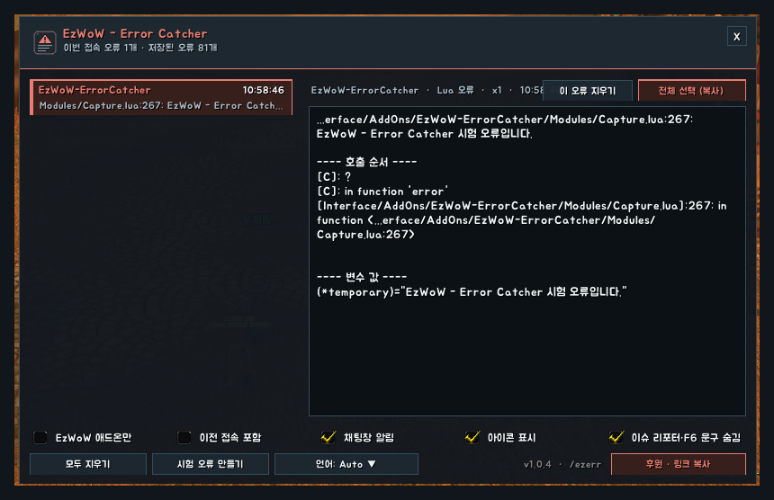
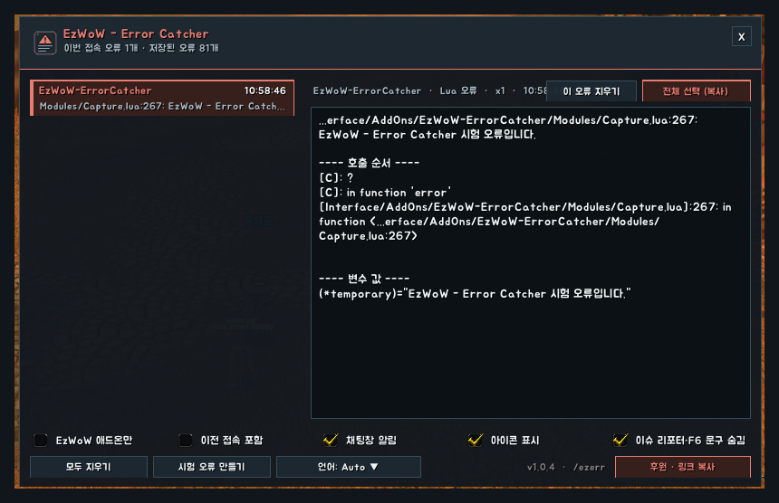

# EzWoW - Error Catcher

Lua 오류·애드온 동작 차단·경고를 창에 모아 보여 주고 복사할 수 있게 합니다.
Collects Lua errors, blocked addon actions and warnings in a window you can copy from.

- 명령어 / Commands: `/ezerr`, `/오류`, `/ezwowerrors` (`/ezerr test` · `/ezerr clear` · `/ezerr icon`)

## 한국어

> 실제 게임 화면입니다(WoW Forever, 한국어 클라이언트). 캐릭터 · 다른 플레이어 이름과 채팅 내용은 가렸습니다.

- 오류가 나면 채팅창에 한 줄 알림(5초에 한 번까지, 그 사이 생긴 수를 덧붙임)이 뜨고, 아이콘에 새 오류 수가 표시됩니다. 전투 중에 난 오류는 채팅창을 건드리지 않도록 전투가 끝난 뒤 알립니다.
- 같은 오류는 한 줄로 묶어 횟수(x12)와 마지막 시각을 보여 줍니다. 이전 접속 오류는 날짜까지 표시합니다(`11/05 22:41:10`).
- 오른쪽 상세 칸에 처음~마지막 시각, 오류 내용·호출 순서·변수 값이 나오며 **전체 선택 (복사)** 후 Ctrl + C로 복사합니다.
- 애드온 동작 차단과 경고도 함께 모읍니다(노란색). 전투 중 지도를 열거나 옮길 때 지도 아이콘의 우클릭 설정이 막혔다는 무해한 알림은 모으지 않습니다.
- EzWoW 애드온만 보기, 이전 접속 포함, 채팅창 알림·아이콘 켜고 끄기, 시험 오류 만들기, 언어(자동 + 8개 언어).
- 최근 오류 300개까지 저장합니다. 오류 내용 1000자, 호출 순서 4000자, 변수 값 2000자를 넘으면 잘라서 저장합니다.
- 게임의 기본 오류 처리는 그대로 두고 그 앞에서 기록만 합니다.
- 게임패드 UI를 쓰는 중에는 게임 기본 오류 창을 띄우지 않고 이 창에만 모읍니다. 오류 창 때문에 패드 조작이 멈추지 않습니다.
- **이슈 리포터·F6 문구 숨김**(기본 켬): 화면에 떠 있는 게임의 이슈 리포터 창과 툴팁 아래의 'F6 버그 제보' 안내 문구를 숨깁니다. 끄면 바로 다시 보입니다. 원래 EzWoW - Tooltip의 설정이었으며, 처음 실행할 때 Tooltip에서 고른 값을 한 번 가져옵니다(Tooltip은 Error Catcher가 없을 때만 이 기능을 씁니다).
- `/ezerr icon`: 아이콘을 다시 켜고 처음 위치로 옮깁니다. 아이콘은 끌어서 옮길 수 있고, 이번 접속에 오류가 없으면 흐리게 보입니다.
- 게임 설정 > 애드온의 **EzWoW - Error Catcher** 항목에서도 오류 창을 열 수 있습니다. 하위 명령은 한국어(`/오류 테스트`·`지우기`·`아이콘`)로도 됩니다.

<!-- ezwow-pad-share -->
### 게임패드
- 게임패드 UI를 켜면 EzWoW 창을 패드로 다룰 수 있습니다. 방향키로 이동, A(✕)로 누르기, X(□)로 오른쪽 클릭, LB/RB로 스크롤, B(○)로 닫기입니다. 창 아래에 연결된 패드 모양으로 키 안내가 나옵니다.
- 블리자드 창이 열려 있지 않을 때 **보기(Back) / Create 버튼**을 누르면 화면의 EzWoW 프레임(유틸리티 바, 퀘스트 목록 등)으로 이동합니다. 다시 누르거나 B를 누르면 돌아갑니다.
- 다른 버튼을 쓰려면 설정 > 단축키 > 애드온 > EzWoW > "게임패드: EzWoW 창으로 이동/돌아가기"에 지정합니다(EzWoW-MapFinder가 설치돼 있을 때).

### 기록 공유
- 모든 EzWoW 애드온이 함께 쓰는 기록 공유가 **기본으로 켜져 있습니다**. 직접 확인한 퀘스트 NPC, 희귀 몬스터 목격, 아이템 드롭, 채집 위치를 다른 EzWoW 사용자와 나눕니다.
- `/ezshare` 또는 `/공유`: `on` / `off` 켜기·끄기, `channel on` / `channel off` 서버 채널 사용, `status` 현재 상태와 기록 수.

## English

> In-game screenshots (WoW Forever, Korean client). Character and player names and chat text are blurred.

- A one-line chat notice (at most every 5 seconds, with the number held back meanwhile) and a counter on the icon when something breaks. Errors in combat are announced once combat ends, so the chat is left alone while fighting.
- Repeated errors are grouped with a count (x12) and the last time. Errors from older sessions also show the date (`11/05 22:41:10`).
- The detail pane shows the first ~ last time, the message, stack and locals; **Select all (copy)**, then Ctrl + C.
- Blocked addon actions and warnings are collected too (gold). Harmless notices about map icon right-click settings being blocked when a map is opened or moved in combat are skipped.
- EzWoW addons only, older sessions, chat notice and icon on/off, a test error, and language (auto + 8 languages).
- The latest 300 errors are kept. Messages over 1000 characters, stacks over 4000 and locals over 2000 are cut when saved.
- The game's own error handling still runs; errors are only recorded on the way.
- While the gamepad UI is on, errors go only to this window instead of the game's error popup, so pad control never gets stuck.
- **Hide F6 bug report** (on by default): hides the game's floating issue reporter frame and the "Press F6 to submit a bug" line on tooltips. Turning it off shows them again right away. This used to be an EzWoW - Tooltip option; the choice made there is carried over once on the first start (Tooltip only does this itself when Error Catcher is not installed).
- `/ezerr icon` shows the icon again at its default spot. Drag the icon to move it; it is dimmed while there are no errors this session.
- The error window can also be opened from the game's Settings > AddOns, under **EzWoW - Error Catcher**.

### Gamepad
- With the gamepad UI on, EzWoW windows work with a gamepad: D-pad to move, A (✕) to press, X (□) for right-click, LB/RB to scroll, B (○) to close. A key guide in your pad's button style shows under the window.
- With no game window open, press **View (Back) / Create** to move to the EzWoW frames on screen (Utility Bar, quest list and more). Press it again or B to go back.
- To use another button, set Key Bindings > AddOns > EzWoW > "Gamepad: move to / leave the EzWoW frames" (with EzWoW-MapFinder installed).

### Record sharing
- Record sharing, used by all EzWoW addons, is **on by default**. Quest NPCs, rare monster sightings, item drops and gathering spots you have seen yourself are shared with other EzWoW users.
- `/ezshare`: `on` / `off` to turn it on or off, `channel on` / `channel off` for the server channel, `status` for the current state and record counts.

---

## Support / 후원

If you find this addon useful, you can support its development.

애드온이 도움이 되셨다면 개발 후원으로 응원해 주세요.

[Buy Me a Coffee ☕](https://buymeacoffee.com/qqhrqqhr2)

