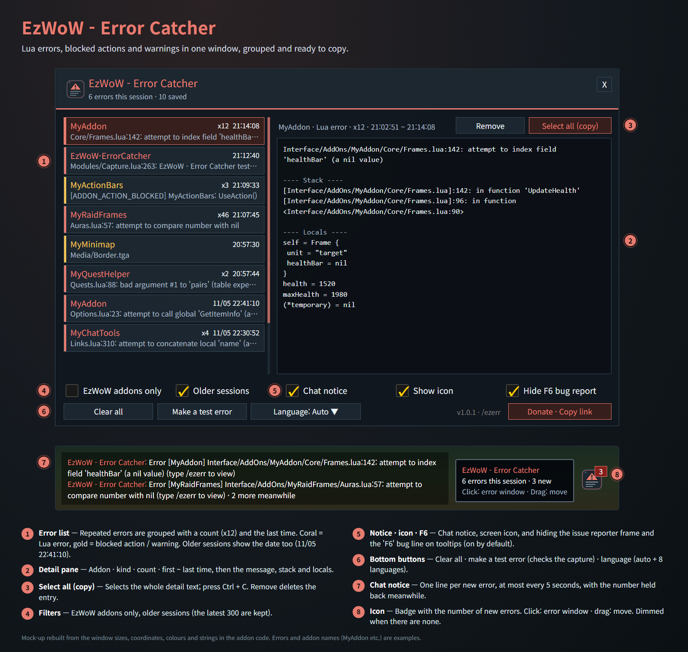
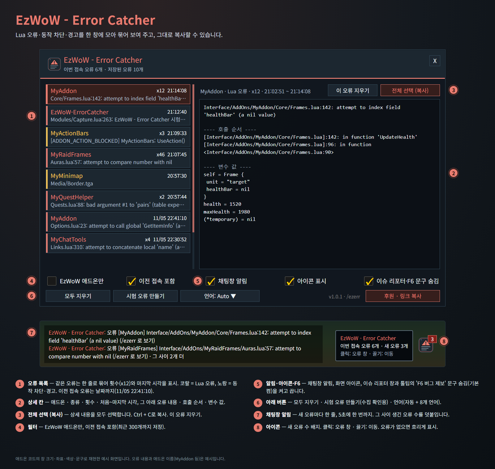

<!--
CurseForge summary (EN): Collects Lua errors, blocked addon actions and warnings in one window, grouped and ready to copy, and hides the issue reporter and F6 tooltip line.
CurseForge summary (KO): Lua 오류·애드온 동작 차단·경고를 한 창에 묶어 보여 주고 복사할 수 있게 하며, 이슈 리포터와 툴팁의 F6 문구를 숨깁니다.
-->

# EzWoW - Error Catcher

**English** · [한국어](#한국어)

An error window for WoW Forever. Lua errors, blocked addon actions and warnings are collected in one place, repeated errors are grouped, and the full text (message, stack and locals) is ready to copy into a bug report. It also hides the game's floating issue reporter and the "F6" line on tooltips.

*Mock-up rebuilt from the window sizes, coordinates, colours and strings in the addon code. Errors and addon names (MyAddon etc.) are examples.*

## Features

### Error window
- Lua errors (coral), blocked addon actions and warnings (gold) in one list.
- Repeated errors are grouped into one row with a count (x12) and the last time; errors from older sessions show the date too.
- The detail pane shows the addon, kind, count, first and last time, then the message, the stack and the local values.
- **Select all (copy)**, then Ctrl + C to copy everything; **Remove** deletes one entry, **Clear all** deletes them all.
- Filters: EzWoW addons only, include older sessions. The latest 300 errors are kept.
- **Make a test error** to check that capturing works.

### Notices
- A one-line chat notice when something breaks (at most every 5 seconds, with the number held back meanwhile).
- A small screen icon with a badge for new errors. Click to open the window, drag to move it.

### Hide F6 bug report (on by default)
- Hides the game's floating issue reporter frame and the "Press F6 to submit a bug" line at the bottom of tooltips.
- Turn it off in the error window to bring them back right away.

### Safe by design
- The game's own error handling keeps running; errors are only recorded on the way.
- Very long messages, stacks and locals are cut when saved so the saved data stays small.

## Working with other EzWoW addons
- The issue reporter option moved here from **EzWoW - Tooltip**. The choice made there is carried over once on the first start.

## Commands
- `/ezerr` or `/오류` — open the error window
- `/ezerr test` — make a test error
- `/ezerr clear` — clear all saved errors
- `/ezerr icon` — show the icon again at its default spot

Languages: English, 한국어, Deutsch, Français, Español, Русский, 简体中文, 繁體中文.

---

## 한국어

WoW Forever용 오류 창입니다. Lua 오류·애드온 동작 차단·경고를 한곳에 모으고, 같은 오류는 한 줄로 묶으며, 오류 내용·호출 순서·변수 값을 그대로 복사해 제보할 수 있습니다. 화면에 떠 있는 게임의 이슈 리포터 창과 툴팁의 'F6' 문구도 숨깁니다.

*애드온 코드의 창 크기·좌표·색상·문구로 재현한 예시 화면입니다. 오류 내용과 애드온 이름(MyAddon 등)은 예시입니다.*

## 기능

### 오류 창
- Lua 오류(코랄)와 애드온 동작 차단·경고(노랑)를 한 목록에 모읍니다.
- 같은 오류는 한 줄로 묶어 횟수(x12)와 마지막 시각을 보여 주고, 이전 접속 오류는 날짜까지 표시합니다.
- 상세 칸에 애드온·종류·횟수·처음~마지막 시각과 오류 내용·호출 순서·변수 값이 나옵니다.
- **전체 선택 (복사)** 후 Ctrl + C로 복사합니다. **이 오류 지우기**로 하나, **모두 지우기**로 전부 지웁니다.
- 필터: EzWoW 애드온만, 이전 접속 포함. 최근 오류 300개까지 저장합니다.
- **시험 오류 만들기**로 수집이 되는지 확인할 수 있습니다.

### 알림
- 오류가 나면 채팅창에 한 줄 알림(5초에 한 번까지, 그 사이 생긴 수를 덧붙임).
- 새 오류 수 배지가 붙은 화면 아이콘. 클릭하면 오류 창, 끌면 이동.

### 이슈 리포터·F6 문구 숨김 (기본 켬)
- 화면에 떠 있는 게임의 이슈 리포터 창과 툴팁 아래의 'F6 버그 제보' 안내 문구를 숨깁니다.
- 오류 창에서 끄면 바로 다시 보입니다.

### 안전한 동작
- 게임의 기본 오류 처리는 그대로 두고 그 앞에서 기록만 합니다.
- 아주 긴 오류 내용·호출 순서·변수 값은 잘라서 저장해 저장 데이터를 작게 유지합니다.

## 다른 EzWoW 애드온과 함께 쓰기
- 이슈 리포터 숨김 설정은 **EzWoW - Tooltip**에서 이 애드온으로 옮겨 왔습니다. 처음 실행할 때 Tooltip에서 고른 값을 한 번 가져옵니다.

## 명령어
- `/ezerr` 또는 `/오류` — 오류 창 열기
- `/ezerr test` — 시험 오류 만들기
- `/ezerr clear` — 저장된 오류 모두 지우기
- `/ezerr icon` — 아이콘을 다시 켜고 처음 위치로

지원 언어: English, 한국어, Deutsch, Français, Español, Русский, 简体中文, 繁體中文.
